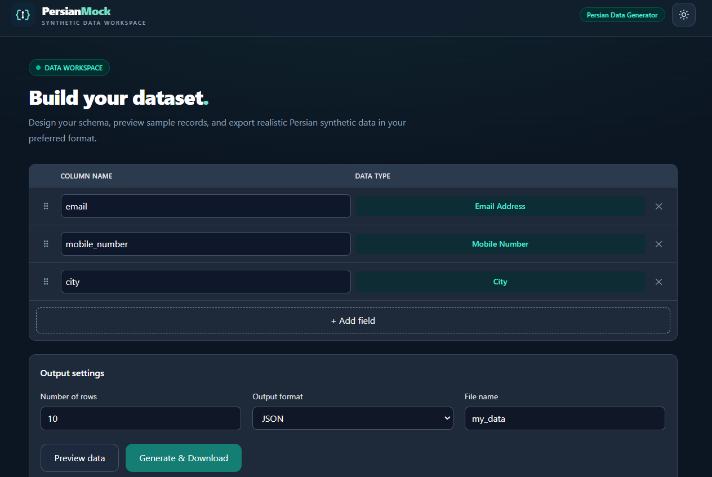

# PersianMock Frontend

**A responsive Vue interface for generating and exporting Persian and Iranian synthetic sample data.**

This repository is the **frontend** for PersianMock. The FastAPI backend, PostgreSQL reference database, and data-generation logic are maintained in a separate repository.

> **Status:** Portfolio/MVP project. Start the backend locally before using API-powered features.

## Preview



## Features

- Schema builder with add/remove, editable column names, and drag-and-drop ordering
- Searchable field picker grouped by Personal, Location, Vehicle, and Identifiers
- Field catalog fetched from the backend
- Row count from 1 to 10,000
- Small data preview (up to five sample rows) and **Copy JSON**
- JSON, CSV, SQL, and Excel downloads
- Optional SQL `CREATE TABLE` statement
- API loading/error feedback, client-side validation
- Responsive layout and persisted light/dark preference
- Support for displaying Persian values in a primarily English UI

## Stack

- Vue 3 (Composition API)
- Vite
- Tailwind CSS 4
- Axios
- VueDraggable

## Getting started

### Prerequisites

- Node.js/npm compatible with the project's Vite version
- PersianMock backend running (default local URL: `http://127.0.0.1:8001`)

### Install and run

From the frontend repository root:

```bash
npm install
```

Create `.env.local`:

```dotenv
VITE_API_BASE_URL=http://127.0.0.1:8001
```

Then:

```bash
npm run dev
```

Open the local URL shown by Vite in the terminal (commonly `http://localhost:5173`).

### Build

```bash
npm run build
npm run preview
```

Vite writes built assets to `dist/`. This README does not claim that the application is publicly hosted.

## Backend integration

| Endpoint | Usage |
| --- | --- |
| `GET /fields/` | Get the available data types |
| `POST /generate/` | Preview or download generated records |

The frontend's API client is in `src/services/api.js`. It reads `VITE_API_BASE_URL`, which defaults to `http://127.0.0.1:8001` if not set.

- **Preview** requests JSON and up to five rows.
- **Download** requests the selected export format and row count.
- Preview and downloaded rows may differ because each request generates new random data.
- The backend automatically provides `id`; the UI does not offer it as a custom field.
- `password` contains a bcrypt **hash**, not plaintext.

The backend must allow the frontend development origin in its CORS settings.

## Typical workflow

1. Click **Add field** and choose one or more field types.
2. Optionally rename and reorder the columns.
3. Choose the number of rows, output format, and filename/table name.
4. Click **Preview data** to inspect a small sample.
5. Click **Generate & Download** to export the requested data.

## Project layout

```text
src/
  components/
    AddFieldModal.vue
    DataPreview.vue
    FieldRow.vue
    Header.vue
    MainContent.vue
    ThemeToggle.vue
  services/
    api.js
  App.vue
  index.css
  main.js
```

## Validation and troubleshooting

- Valid table/column identifiers use ASCII letters/underscores followed by letters/digits/underscores, max 63 characters.
- Column names must be unique; `id` is reserved for the generated ID column.
- Row count must be between 1 and 10,000.
- If the field picker shows a connection error, confirm the backend is running and `VITE_API_BASE_URL` is correct.
- If browser requests are blocked, confirm the backend CORS configuration allows your Vite origin.

## Checks

```bash
npm run build
```

During MVP development, frontend features were **manually tested** (field picker, drag-and-drop, validation, preview, Copy JSON, all four downloads, dark mode, and password generation). No automated frontend test suite is claimed.

## Limitations

PersianMock is a local-development portfolio project, not a deployed SaaS service. It does not manage user accounts or store generated records in the frontend. Synthetic mobile/postal data may match real assignments by chance.

## Backend

See the separate **PersianMock Backend** repository for API implementation, PostgreSQL setup, data seeding, and backend tests.

## License

No license is implied by this README. Add a `LICENSE` file only after choosing the terms under which you want to share this repository.
